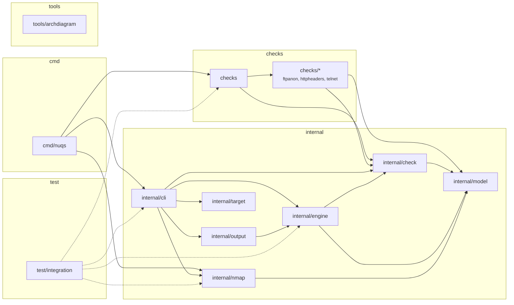

# Architecture

!!! note "This page is generated"
    `tools/archdiagram` builds it from the code on every push, so it always matches what's in the repo. Don't edit it by hand. To change a description, change the package's doc comment.

## How the packages connect

An arrow means "uses". For example `internal/cli --> internal/engine` means the CLI calls the engine. Dotted arrows come from test-only packages.



## Packages

| Package | What it does | Uses |
|---|---|---|
| `checks` | Lists every check that ships with Nuqs. | `checks/ftpanon`, `checks/httpheaders`, `checks/telnet`, `internal/check` |
| `checks/ftpanon` | Checks if an FTP server lets anyone log in as "anonymous". | `internal/check`, `internal/model` |
| `checks/httpheaders` | Checks web servers for missing security headers. | `internal/check`, `internal/model` |
| `checks/telnet` | Flags open Telnet services. | `internal/check`, `internal/model` |
| `cmd/nuqs` | The Nuqs vulnerability scanner. | `checks`, `internal/cli`, `internal/nmap` |
| `internal/check` | Defines what a check is. | `internal/model` |
| `internal/cli` | The "nuqs" command line. | `internal/check`, `internal/engine`, `internal/nmap`, `internal/output`, `internal/target` |
| `internal/engine` | Runs a scan from start to end. | `internal/check`, `internal/model` |
| `internal/model` | Holds the small set of types that every part of Nuqs shares. | nothing else in Nuqs |
| `internal/nmap` | Runs Nmap and turns its XML output into model.Host values. | `internal/model` |
| `internal/output` | Prints a scan report, either as a table for people or as JSON for tools. | `internal/engine` |
| `internal/target` | Checks what the user asked us to scan before it ever reaches Nmap. | nothing else in Nuqs |
| `test/integration` (tests) | Runs the whole scan with the real Nmap binary. | `checks`, `internal/cli`, `internal/engine`, `internal/nmap` |
| `tools/archdiagram` | Writes docs/architecture.md, a diagram and a map of the repo built straight from the code. | nothing else in Nuqs |

## What's where

Every file in the repo, as git sees it. Files CI generates (like the API pages) aren't listed.

```text
.
├── .github/                      # GitHub settings.
│   └── workflows/                # CI jobs. They run on every push and pull request.
│       ├── architecture.yml
│       ├── ci.yml
│       └── docs.yml
├── checks/                       # Lists every check that ships with Nuqs.
│   ├── ftpanon/                  # Checks if an FTP server lets anyone log in as "anonymous".
│   │   ├── ftpanon.go
│   │   └── ftpanon_test.go
│   ├── httpheaders/              # Checks web servers for missing security headers.
│   │   ├── httpheaders.go
│   │   └── httpheaders_test.go
│   ├── telnet/                   # Flags open Telnet services.
│   │   ├── telnet.go
│   │   └── telnet_test.go
│   ├── checks.go
│   └── checks_test.go
├── cmd/                          # Programs you can run. Each folder here is one binary.
│   └── nuqs/                     # The Nuqs vulnerability scanner.
│       └── main.go
├── docs/                         # The website. Edit these pages, CI publishes them.
│   ├── design/                   # Why we made the big decisions.
│   │   ├── content-pipeline.md
│   │   ├── decisions.md
│   │   └── differentiators.md
│   ├── architecture.md
│   ├── contributing.md
│   ├── getting-started.md
│   ├── how-it-works.md
│   ├── index.md
│   ├── progress.md
│   ├── requirements.txt
│   ├── roadmap.md
│   ├── testing.md
│   └── writing-a-check.md
├── internal/                     # The core of Nuqs. Only code in this repo can import these.
│   ├── check/                    # Defines what a check is.
│   │   ├── check.go
│   │   └── check_test.go
│   ├── cli/                      # The "nuqs" command line.
│   │   ├── testdata/             # Sample files used by the tests next to it.
│   │   │   └── router.xml
│   │   ├── cli.go
│   │   └── cli_test.go
│   ├── engine/                   # Runs a scan from start to end.
│   │   ├── engine.go
│   │   └── engine_test.go
│   ├── model/                    # Holds the small set of types that every part of Nuqs shares.
│   │   ├── model.go
│   │   └── model_test.go
│   ├── nmap/                     # Runs Nmap and turns its XML output into model.Host values.
│   │   ├── testdata/             # Sample files used by the tests next to it.
│   │   │   └── scan.xml
│   │   ├── nmap.go
│   │   └── nmap_test.go
│   ├── output/                   # Prints a scan report, either as a table for people or as JSON for tools.
│   │   ├── output.go
│   │   └── output_test.go
│   └── target/                   # Checks what the user asked us to scan before it ever reaches Nmap.
│       ├── target.go
│       └── target_test.go
├── scripts/                      # Small helper scripts used by CI.
│   ├── docs.sh
│   └── gen-api-docs.sh
├── test/                         # Tests that need real tools, like Nmap.
│   └── integration/              # Runs the whole scan with the real Nmap binary.
│       └── integration_test.go
├── tools/                        # Helper programs for developing Nuqs. Not part of the scanner.
│   └── archdiagram/              # Writes docs/architecture.md, a diagram and a map of the repo built straight from the code.
│       ├── testdata/             # Sample files used by the tests next to it.
│       │   └── repo/
│       │       ├── a/
│       │       │   ├── testdata/ # Sample files used by the tests next to it.
│       │       │   │   └── fixture.go
│       │       │   ├── a.go
│       │       │   └── a_test.go
│       │       ├── b/
│       │       │   └── b.go
│       │       ├── checks/
│       │       │   ├── x/
│       │       │   │   └── x.go
│       │       │   └── y/
│       │       │       └── y.go
│       │       ├── cmd/
│       │       │   └── app/
│       │       │       └── main.go
│       │       ├── docs/
│       │       │   └── index.md
│       │       ├── test/
│       │       │   └── e2e/
│       │       │       └── e2e_test.go
│       │       └── go.mod
│       ├── arch.go
│       ├── arch_test.go
│       ├── main.go
│       └── render.go
├── .gitignore
├── .golangci.yml
├── README.md
├── go.mod
└── mkdocs.yml
```
