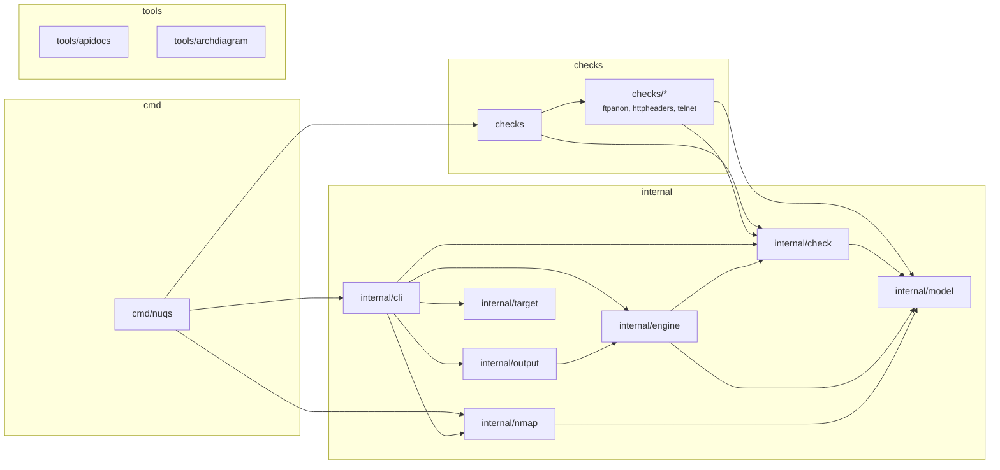

# Architecture

!!! note "This page is generated"
    `tools/archdiagram` builds it from the code on every push, so it always matches what's in the repo. Don't edit it by hand. Every description comes from the file itself: the package doc comment for folders, and the one-line comment at the top of each file.

## How the packages connect

An arrow means "uses". For example `internal/cli --> internal/engine` means the CLI calls the engine.



## Packages

| Package | What it does | Uses |
|---|---|---|
| `checks` | Lists every check that ships with Nuqs. | `checks/ftpanon`, `checks/httpheaders`, `checks/telnet`, `internal/check` |
| `checks/ftpanon` | Checks if an FTP server lets anyone log in as "anonymous". | `internal/check`, `internal/model` |
| `checks/httpheaders` | Checks web servers for missing security headers. | `internal/check`, `internal/model` |
| `checks/telnet` | Flags open Telnet services. | `internal/check`, `internal/model` |
| `cmd/nuqs` | The Nuqs vulnerability scanner. | `checks`, `internal/cli`, `internal/nmap` |
| `internal/check` | Defines what a check is. | `internal/model` |
| `internal/cli` | The "nuqs" command line. | `internal/check`, `internal/engine`, `internal/nmap`, `internal/output`, `internal/target` |
| `internal/engine` | Runs a scan from start to end. | `internal/check`, `internal/model` |
| `internal/model` | Holds the small set of types that every part of Nuqs shares. | nothing else in Nuqs |
| `internal/nmap` | Runs Nmap and turns its XML output into model.Host values. | `internal/model` |
| `internal/output` | Prints a scan report, either as a table for people or as JSON for tools. | `internal/engine` |
| `internal/target` | Checks what the user asked us to scan before it ever reaches Nmap. | nothing else in Nuqs |
| `tools/apidocs` | Writes the API reference pages of the website, one page per package, from the doc comments in the code. | nothing else in Nuqs |
| `tools/archdiagram` | Writes docs/architecture.md, a diagram and a map of the repo built straight from the code. | nothing else in Nuqs |

## What's where

Every file in the repo, as git sees it, except the `docs/` and `test/` folders.

```text
.
├── .github/                            # GitHub settings.
│   └── workflows/                      # CI jobs. They run on every push and pull request.
│       ├── architecture.yml            # Rebuilds docs/architecture.md on every push and commits it if it changed.
│       ├── ci.yml                      # Tests, lint, fuzzing, the real Nmap test and builds, on every push and pull request.
│       └── docs.yml                    # Builds the docs website on every pull request and publishes it from the default branch.
├── checks/                             # Lists every check that ships with Nuqs.
│   ├── ftpanon/                        # Checks if an FTP server lets anyone log in as "anonymous".
│   │   ├── ftpanon.go
│   │   └── ftpanon_test.go             # Tests the FTP check against a small fake FTP server.
│   ├── httpheaders/                    # Checks web servers for missing security headers.
│   │   ├── httpheaders.go
│   │   └── httpheaders_test.go         # Tests the web headers check against local test servers.
│   ├── telnet/                         # Flags open Telnet services.
│   │   ├── telnet.go
│   │   └── telnet_test.go              # Tests the Telnet check.
│   ├── checks.go
│   └── checks_test.go                  # Makes sure every built-in check is valid, tested and listed.
├── cmd/                                # Programs you can run. Each folder here is one binary.
│   └── nuqs/                           # The Nuqs vulnerability scanner.
│       └── main.go
├── internal/                           # The core of Nuqs. Only code in this repo can import these.
│   ├── check/                          # Defines what a check is.
│   │   ├── check.go
│   │   └── check_test.go               # Tests when checks apply and how check lists are validated.
│   ├── cli/                            # The "nuqs" command line.
│   │   ├── testdata/                   # Sample files used by the tests next to it (1 file).
│   │   ├── cli.go
│   │   └── cli_test.go                 # Runs the whole CLI with a fake Nmap, so no network is needed.
│   ├── engine/                         # Runs a scan from start to end.
│   │   ├── engine.go
│   │   └── engine_test.go              # Tests the engine: timeouts, panics, cancelling, the worker limit and sorting.
│   ├── model/                          # Holds the small set of types that every part of Nuqs shares.
│   │   ├── model.go
│   │   └── model_test.go               # Tests severities, finding IDs and the JSON shape.
│   ├── nmap/                           # Runs Nmap and turns its XML output into model.Host values.
│   │   ├── testdata/                   # Sample files used by the tests next to it (1 file).
│   │   ├── nmap.go
│   │   └── nmap_test.go                # Tests building the Nmap command, reading its XML and running it.
│   ├── output/                         # Prints a scan report, either as a table for people or as JSON for tools.
│   │   ├── output.go
│   │   └── output_test.go              # Tests the text and JSON reports.
│   └── target/                         # Checks what the user asked us to scan before it ever reaches Nmap.
│       ├── target.go
│       └── target_test.go              # Tests target parsing and the safety limit, and fuzzes it with random input.
├── scripts/                            # Small helper scripts used by CI.
│   └── docs.sh                         # Builds the docs website.
├── tools/                              # Helper programs for developing Nuqs. Not part of the scanner.
│   ├── apidocs/                        # Writes the API reference pages of the website, one page per package, from the doc comments in the code.
│   │   ├── testdata/                   # Sample files used by the tests next to it (7 files).
│   │   ├── apidocs.go                  # Finds the packages, reads their docs and writes one Markdown page each.
│   │   ├── apidocs_test.go             # Tests for the API page generator, run against a small fake module.
│   │   └── main.go
│   └── archdiagram/                    # Writes docs/architecture.md, a diagram and a map of the repo built straight from the code.
│       ├── testdata/                   # Sample files used by the tests next to it (11 files).
│       ├── arch.go                     # Reads the repo: its packages, what they import, and its files.
│       ├── arch_test.go                # Tests the generator, and checks it against go list so the diagram is always right.
│       ├── main.go
│       ├── notes.go                    # Reads the one-line description at the top of each file.
│       ├── notes_test.go               # Tests reading the one-line description at the top of each kind of file.
│       └── render.go                   # Turns what we read into the architecture page: diagram, table and file tree.
├── .gitignore                          # Files git should ignore, like build output and generated docs.
├── .golangci.yml                       # Lint settings.
├── README.md                           # The front page of the repo: what Nuqs is and how to start.
├── go.mod                              # The Go module for Nuqs.
└── mkdocs.yml                          # Settings for the docs website (MkDocs Material).
```
