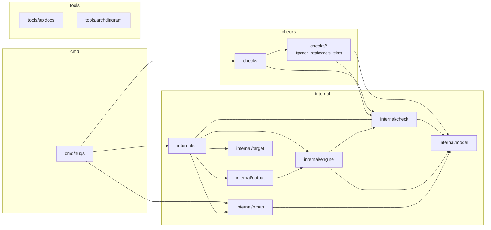

# Architecture

!!! note "This page is generated"
    `tools/archdiagram` builds it from the code on every push, so it always matches what's in the repo. Don't edit it by hand. Every description comes from the file itself: the package doc comment for folders, and the one-line comment at the top of each file.

## How the packages connect

An arrow means "uses". For example `internal/cli --> internal/engine` means the CLI calls the engine.

## Packages

| Package | What it does | Uses |
|---|---|---|
| `checks` | Lists every check that ships with Nuqs. | `checks/ftpanon`, `checks/httpheaders`, `checks/telnet`, `internal/check` |
| `checks/ftpanon` | Checks if an FTP server lets anyone log in as "anonymous". | `internal/check`, `internal/model` |
| `checks/httpheaders` | Checks web servers for missing security headers. | `internal/check`, `internal/model` |
| `checks/telnet` | Flags open Telnet services. | `internal/check`, `internal/model` |
| `cmd/nuqs` | The Nuqs vulnerability assessment tool. | `checks`, `internal/cli`, `internal/nmap` |
| `internal/check` | Defines what a check is. | `internal/model` |
| `internal/cli` | The "nuqs" command line. | `internal/check`, `internal/engine`, `internal/nmap`, `internal/output`, `internal/target` |
| `internal/engine` | Runs a scan from start to end. | `internal/check`, `internal/model` |
| `internal/model` | Holds the small set of types that every part of Nuqs shares. | nothing else in Nuqs |
| `internal/nmap` | Runs Nmap and turns its XML output into model.Host values. | `internal/model` |
| `internal/output` | Prints a scan report, either as a table for people or as JSON for tools. | `internal/engine` |
| `internal/target` | Checks what the user asked us to scan before it ever reaches Nmap. | nothing else in Nuqs |
| `tools/apidocs` | Writes the API reference pages of the website, one page per package, from the doc comments in the code. | nothing else in Nuqs |
| `tools/archdiagram` | Writes docs/architecture.md, a diagram and a map of the repo built straight from the code. | nothing else in Nuqs |

## What's where

Every file in the repo, as git sees it, except the `docs/` and `test/` folders. Click a folder to open or close it.

<ul>
<li>

<code>.github/</code> GitHub settings.

<ul>
<li>

<code>workflows/</code> CI jobs. They run on every push and pull request.

<ul>
<li><code>architecture.yml</code> Rebuilds docs/architecture.md on every push to master and commits it if it changed.</li>
<li><code>ci.yml</code> Tests, lint, fuzzing, the real Nmap test and builds, on every push and pull request.</li>
<li><code>docs.yml</code> Builds the docs website on every pull request and publishes it from the default branch.</li>
</ul>

</li>
</ul>

</li>
<li>

<code>checks/</code> Lists every check that ships with Nuqs.

<ul>
<li>

<code>ftpanon/</code> Checks if an FTP server lets anyone log in as &#34;anonymous&#34;.

<ul>
<li><code>ftpanon.go</code></li>
<li><code>ftpanon_test.go</code> Tests the FTP check against a small fake FTP server.</li>
</ul>

</li>
<li>

<code>httpheaders/</code> Checks web servers for missing security headers.

<ul>
<li><code>httpheaders.go</code></li>
<li><code>httpheaders_test.go</code> Tests the web headers check against local test servers.</li>
</ul>

</li>
<li>

<code>telnet/</code> Flags open Telnet services.

<ul>
<li><code>telnet.go</code></li>
<li><code>telnet_test.go</code> Tests the Telnet check.</li>
</ul>

</li>
<li><code>checks.go</code></li>
<li><code>checks_test.go</code> Makes sure every built-in check is valid, tested and listed.</li>
</ul>

</li>
<li>

<code>cmd/</code> Programs you can run. Each folder here is one binary.

<ul>
<li>

<code>nuqs/</code> The Nuqs vulnerability assessment tool.

<ul>
<li><code>main.go</code></li>
</ul>

</li>
</ul>

</li>
<li>

<code>internal/</code> The core of Nuqs. Only code in this repo can import these.

<ul>
<li>

<code>check/</code> Defines what a check is.

<ul>
<li><code>check.go</code></li>
<li><code>check_test.go</code> Tests when checks apply and how check lists are validated.</li>
</ul>

</li>
<li>

<code>cli/</code> The &#34;nuqs&#34; command line.

<ul>
<li class="folder"><code>testdata/</code> Sample files used by the tests next to it (1 file).</li>
<li><code>cli.go</code></li>
<li><code>cli_test.go</code> Runs the whole CLI with a fake Nmap, so no network is needed.</li>
</ul>

</li>
<li>

<code>engine/</code> Runs a scan from start to end.

<ul>
<li><code>engine.go</code></li>
<li><code>engine_test.go</code> Tests the engine: timeouts, panics, cancelling, the worker limit and sorting.</li>
</ul>

</li>
<li>

<code>model/</code> Holds the small set of types that every part of Nuqs shares.

<ul>
<li><code>model.go</code></li>
<li><code>model_test.go</code> Tests severities, finding IDs and the JSON shape.</li>
</ul>

</li>
<li>

<code>nmap/</code> Runs Nmap and turns its XML output into model.Host values.

<ul>
<li class="folder"><code>testdata/</code> Sample files used by the tests next to it (1 file).</li>
<li><code>nmap.go</code></li>
<li><code>nmap_test.go</code> Tests building the Nmap command, reading its XML and running it.</li>
</ul>

</li>
<li>

<code>output/</code> Prints a scan report, either as a table for people or as JSON for tools.

<ul>
<li><code>output.go</code></li>
<li><code>output_test.go</code> Tests the text and JSON reports.</li>
</ul>

</li>
<li>

<code>target/</code> Checks what the user asked us to scan before it ever reaches Nmap.

<ul>
<li><code>target.go</code></li>
<li><code>target_test.go</code> Tests target parsing and the safety limit, and fuzzes it with random input.</li>
</ul>

</li>
</ul>

</li>
<li>

<code>scripts/</code> Small helper scripts used by CI.

<ul>
<li><code>docs.sh</code> Builds the docs website.</li>
</ul>

</li>
<li>

<code>tools/</code> Helper programs for developing Nuqs. Not part of the scanner.

<ul>
<li>

<code>apidocs/</code> Writes the API reference pages of the website, one page per package, from the doc comments in the code.

<ul>
<li class="folder"><code>testdata/</code> Sample files used by the tests next to it (7 files).</li>
<li><code>apidocs.go</code> Finds the packages, reads their docs and writes one Markdown page each.</li>
<li><code>apidocs_test.go</code> Tests for the API page generator, run against a small fake module.</li>
<li><code>main.go</code></li>
</ul>

</li>
<li>

<code>archdiagram/</code> Writes docs/architecture.md, a diagram and a map of the repo built straight from the code.

<ul>
<li class="folder"><code>testdata/</code> Sample files used by the tests next to it (11 files).</li>
<li><code>arch.go</code> Reads the repo: its packages, what they import, and its files.</li>
<li><code>arch_test.go</code> Tests the generator, and checks it against go list so the diagram is always right.</li>
<li><code>main.go</code></li>
<li><code>notes.go</code> Reads the one-line description at the top of each file.</li>
<li><code>notes_test.go</code> Tests reading the one-line description at the top of each kind of file.</li>
<li><code>render.go</code> Turns what we read into the architecture page: diagram, table and file tree.</li>
</ul>

</li>
</ul>

</li>
<li><code>.gitignore</code> Files git should ignore, like build output and generated docs.</li>
<li><code>.golangci.yml</code> Lint settings.</li>
<li><code>LICENSE</code></li>
<li><code>README.md</code> The front page of the repo: what Nuqs is and how to start.</li>
<li><code>SECURITY.md</code> How to report a security problem in Nuqs.</li>
<li><code>go.mod</code> The Go module for Nuqs.</li>
<li><code>mkdocs.yml</code> Settings for the docs website (MkDocs Material).</li>
</ul>

