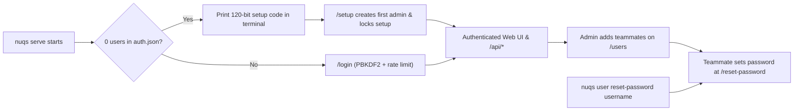

<!-- Accounts, roles, persistent auth storage, password recovery and HTTPS serving for nuqs serve. -->

# Accounts, roles & HTTPS

`nuqs serve` includes built-in user accounts, role-based access control, persistent sessions, password recovery and HTTPS network serving, all built with Go's standard library and zero external dependencies.

It works the same way whether you run Nuqs alone on your laptop or share it with your team over the local network.

## How it works



1. **First run is locked to the host machine.** When `nuqs serve` starts with no accounts yet, it prints a one-time setup code in the terminal. Opening the web UI redirects to `/setup`, where that code lets you create the first **admin** account. Once claimed, `/setup` closes permanently and restarts never print a setup code again.
2. **Normal sign-in and persistent sessions.** After setup, every browser and API request requires a valid session. Accounts and sessions are persisted in `auth.json` inside `--data`, so sign-ins survive server restarts.
3. **Team onboarding without sharing passwords.** Admins create teammates on `/users` with a role (`admin`, `scanner` or `viewer`) and receive a one-time code valid for 1 hour. Each teammate opens `/reset-password` and sets their own password.
4. **Password recovery from UI or terminal.** If someone forgets their password, an admin can reset it on `/users`, or anyone with access to the server machine can run `nuqs user reset-password <username>`. Both revoke all active sessions for that user immediately and issue a fresh one-time code.
5. **Safe network sharing over HTTPS.** Plain HTTP is only allowed on loopback (`127.0.0.1`, `::1` or `localhost`). Listening on the network requires HTTPS via `--tls-self-signed` or `--tls-cert` and `--tls-key`.

## How to run

### Prerequisites

- **Go 1.24** or newer
- **Nmap** installed and available on your `PATH` (or passed via `--nmap`)

### Build

```bash
go build -o nuqs ./cmd/nuqs
```

On Windows:

```powershell
go build -o nuqs.exe ./cmd/nuqs
```

### 1. Run locally (single user)

```bash
./nuqs serve
```

On the very first start, the terminal prints:

```text
Nuqs web UI at http://127.0.0.1:9002 (listening on 127.0.0.1:9002)

First-time setup required (no accounts exist yet).
Open http://127.0.0.1:9002/setup and enter this one-time setup code:
  XXXX-XXXX-XXXX-XXXX-XXXX-XXXX
```

1. Open `http://127.0.0.1:9002/setup` in your browser.
2. Paste the one-time setup code (spaces, hyphens and letter case are normalized automatically).
3. Choose your admin username (2–32 chars, starting with a letter or number) and password (10–128 chars).
4. You are signed in as `admin` and taken straight to `/scans`. The setup code stops working permanently.

To allow scanning hosts beyond `127.0.0.0/8`, add `--allow`:

```bash
./nuqs serve --allow 192.168.1.0/24
```

### 2. Share on your network (HTTPS)

`nuqs serve` refuses plain HTTP on non-loopback addresses. Pick one of two HTTPS options:

**Option A — Auto-generated self-signed certificate (fastest for LAN teams):**

```bash
./nuqs serve --addr 0.0.0.0:9002 --tls-self-signed --allow 192.168.1.0/24
```

Nuqs creates and reuses an ECDSA P-256 certificate (`tls-cert.pem` and `tls-key.pem`) in `--data`, valid for 365 days with `localhost`, loopback and your machine's LAN IP SANs, and automatically renews it within 7 days of expiry. The terminal prints both your local link and a `Team LAN URL` to share with teammates.

**Option B — Your own PEM certificate and key (Let's Encrypt or internal CA):**

```bash
./nuqs serve --addr 0.0.0.0:9443 \
  --tls-cert /path/to/cert.pem \
  --tls-key /path/to/key.pem \
  --allow 192.168.1.0/24
```

### 3. Add teammates and manage roles

1. Sign in as an **admin** and open **Users** (`/users`) from the sidebar.
2. Enter a teammate's username, pick a role (`admin`, `scanner` or `viewer`) and click **Add user**.
3. Copy the one-time password code shown in the banner (valid for 1 hour) and send it with the link `/reset-password?user=<username>`.
4. Your teammate visits `/reset-password`, enters the code, sets their own password and signs in at `/login`.

From `/users`, admins can also change any account's role, issue a new password reset code or remove an account. Nuqs blocks removing your own account and blocks deleting or demoting the last remaining admin.

### 4. Reset a forgotten password

- **From the web UI:** An admin clicks **Reset** next to the user on `/users`.
- **From the server terminal (works even if every admin is locked out):**

```bash
./nuqs user reset-password <username>
```

If you started `nuqs serve` with a custom `--data` directory, pass the same `--data <dir>` flag here:

```bash
./nuqs user reset-password --data /var/lib/nuqs <username>
```

A cross-process lockfile (`auth.lock`) coordinates safely with a running `nuqs serve` process. All existing sessions for that user are revoked immediately, and the printed 1-hour one-time code can be redeemed at `/reset-password`.

### 5. Change your own password or sign out

Click your account card at the bottom of the sidebar to open the account dialog. Changing your password verifies your current password, revokes older sessions and issues a fresh session cookie for your current browser.

## CLI flags & environment variables

### `nuqs serve`

| Flag | Environment variable | Default | Purpose |
|---|---|---|---|
| `--addr` | `PORT` (uses `127.0.0.1:$PORT`) | `127.0.0.1:9002` | Listen address (`host:port`). Non-loopback requires HTTPS |
| `--data` | `NUQS_DATA_DIR` | `<UserConfigDir>/nuqs` | Directory for `auth.json`, `auth.lock` and self-signed TLS certs |
| `--allow` | `NUQS_ALLOWED_TARGETS` | `127.0.0.0/8` | Comma-separated allowed target IPs or CIDRs |
| `--nmap` | `NUQS_NMAP_PATH` | `nmap` from `PATH` | Path to the Nmap binary |
| `--tls-self-signed` | — | `false` | Generate and reuse a local self-signed HTTPS cert in `--data` |
| `--tls-cert` | `NUQS_TLS_CERT` | — | Path to PEM TLS certificate (must be paired with `--tls-key`) |
| `--tls-key` | `NUQS_TLS_KEY` | — | Path to PEM TLS private key (must be paired with `--tls-cert`) |

### `nuqs user reset-password`

| Flag | Environment variable | Default | Purpose |
|---|---|---|---|
| `--data` | `NUQS_DATA_DIR` | `<UserConfigDir>/nuqs` | Directory containing `auth.json` |

## Roles & permissions

Every web route and JSON API route enforces the caller's role server-side.

| Action | `admin` | `scanner` | `viewer` |
|---|---|---|---|
| View scans, hosts, findings & check library | Yes | Yes | Yes |
| Start and stop scans (`/scans/new`, `/api/scans`) | Yes | Yes | No (`403`) |
| Scan attribution (`started_by` set from session) | Yes | Yes | — |
| Change own password & sign out | Yes | Yes | Yes |
| Manage teammates & roles (`/users`, `/api/users`) | Yes | No (`403`) | No (`403`) |

Scan records automatically store `started_by` from the authenticated session (ignored in incoming JSON payloads so API clients cannot spoof another username) and display it on both `/scans` and `/scans/{id}`.

## Routes reference

### Web UI routes

| Method & path | Access | Purpose |
|---|---|---|
| `GET /setup`, `POST /setup` | Only while 0 users exist | Verify terminal setup code and create first `admin` |
| `GET /login`, `POST /login` | Public (after setup) | Sign in and receive `nuqs_session` cookie |
| `POST /logout` | Signed-in user | Revoke current session and clear cookie |
| `GET /reset-password`, `POST /reset-password` | Public (after setup) | Redeem one-time invite/reset code and set password |
| `POST /account/password` | Signed-in user | Change own password and rotate session |
| `GET /users`, `POST /users` | `admin` | List teammates and create account with invite code |
| `POST /users/{id}/role` | `admin` | Change a teammate's role |
| `POST /users/{id}/reset` | `admin` | Issue a 1-hour reset code and revoke user's sessions |
| `POST /users/{id}/delete` | `admin` | Delete an account (self and last-admin blocked) |

### JSON API routes

All `/api/*` endpoints require a valid `nuqs_session` cookie (returning `401` otherwise). State-changing requests verify same-origin headers.

| Method & path | Access | Response |
|---|---|---|
| `GET /api/users` | `admin` | `200 OK` JSON array of users (no password hashes) |
| `POST /api/users` | `admin` | `201 Created` `{"user": ..., "reset_code": "..."}` |
| `PATCH /api/users/{id}` | `admin` | `200 OK` updated user (`409` if demoting last admin) |
| `POST /api/users/{id}/reset-password` | `admin` | `200 OK` `{"user_id", "username", "code", "expires_at"}` |
| `DELETE /api/users/{id}` | `admin` | `204 No Content` (`400` self-delete, `409` last admin) |

## Storage & security details

### Data files in `--data` (created with `0700`)

| File | Permissions | Contents |
|---|---|---|
| `auth.json` | `0600` | Versioned JSON written atomically via temp file + rename. Stores users, SHA-256 hashed session tokens and SHA-256 hashed one-time codes |
| `auth.lock` | `0600` | Cross-process lockfile (5s wait timeout, 30s stale lock recovery) coordinating `nuqs serve` and `nuqs user reset-password` |
| `tls-cert.pem`, `tls-key.pem` | `0644`, `0600` | Self-signed ECDSA P-256 cert and key when `--tls-self-signed` is enabled |

### Cryptographic & HTTP protections

- **Password hashing (`internal/auth/password.go`):** Go's standard library `crypto/pbkdf2` using PBKDF2-HMAC-SHA256, 600,000 iterations, 16-byte random salt and 32-byte derived key, compared in constant time. Missing usernames run a dummy PBKDF2 derivation to mitigate timing enumeration.
- **One-time codes (`internal/auth/codes.go`):** 120 bits of `crypto/rand` entropy formatted as six 4-character Base32 groups, hashed with SHA-256 before storage, single-use, 1-hour expiry for invites and resets.
- **Sessions (`internal/auth/middleware.go`):** 256-bit `crypto/rand` tokens stored as SHA-256 digests with a 7-day TTL. Issued via `nuqs_session` cookie with `HttpOnly`, `SameSite=Strict`, and `Secure` over HTTPS.
- **Brute-force rate limiting (`internal/auth/ratelimit.go`):** Sliding 15-minute window keyed by direct socket `RemoteAddr` (ignoring spoofable forwarding headers), allowing 5 failures per `(IP, username)` and 15 per `IP`. Exceeding the limit returns `429 Too Many Requests` with `Retry-After`.
- **CSRF & headers:** State-changing POST/PATCH/DELETE handlers require exact scheme + `Host` `Origin` matching (or `Sec-Fetch-Site: same-origin` when Chrome sends `Origin: null`). Auth and app responses set `Cache-Control: no-store`, strict CSP, `X-Frame-Options: DENY`, `X-Content-Type-Options: nosniff`, `Referrer-Policy: same-origin`, and `Strict-Transport-Security: max-age=31536000` on HTTPS. Post-login `next` redirects are restricted to local relative paths via `SafeNext`.
- **TLS:** Minimum TLS 1.2 enforced (`crypto/tls`).

## Code layout & verification

| Package | Responsibility |
|---|---|
| `internal/store` | `AuthStore` interface and atomic, lockfile-backed `FileStore` (`auth.json`) |
| `internal/auth` | Password hashing, one-time codes, sessions, rate limiting, RBAC & HTTP gate middleware |
| `internal/api` | `/api/users` endpoints, `started_by` scan attribution, RBAC & scheme-aware origin checks |
| `internal/web` | Auth pages (`/setup`, `/login`, `/reset-password`, `/users`), account dialog, responsive UI |
| `internal/cli` | `nuqs serve` TLS/setup wiring, `tls.go` self-signed cert manager, `nuqs user reset-password` |
| `internal/tools` | `StartedBy` attribution field on scan records |

Run the full verification suite:

```bash
go test -race ./...
go vet ./...
go run ./tools/archdiagram -check
```

See also [Getting started](getting-started.md), [Pages](ui/pages.md), [How we build it](ui/building.md) and [Architecture](architecture.md).
